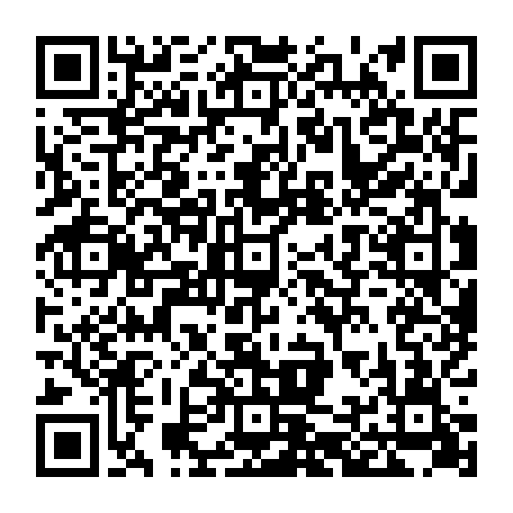

[](https://creativecommons.org/licenses/by-sa/4.0/)


# Rapport Oracle — Middleware

Worker Cloudflare que intermedeia requisições de oracle entre smart contracts
(EVM, Solana, Stellar) e fontes de dados externas, no modelo Oraclize/Provable.

Em construção — consulte `docs/` para arquitetura e runbook de deploy.

## Faucets para teste

Precisa de tokens de teste para experimentar o oracle — POL na Polygon
Amoy, SOL na devnet da Solana ou XLM na testnet da Stellar? Solicite
diretamente
[abrindo uma issue neste repositório](https://github.com/RapportTecnologia/rapport_oracle_middleware/issues/new?title=Solicita%C3%A7%C3%A3o%20de%20Faucet%20para%20teste&body=Rede%3A%20(ex.%3A%20Polygon%20Amoy%2C%20Solana%20devnet%2C%20Stellar%20testnet)%0AEndere%C3%A7o%20da%20carteira%3A%0AQuantidade%20estimada%3A)
ou pela página [Crypto Faucets](https://rapport.tec.br/crypto-faucets/)
da Rapport.

## Apoie o Projeto — Doação via Pix

O Rapport Oracle é mantido de forma independente. Se o projeto é útil para
você, apoie com uma doação via Pix a título de retribuição e incentivo:
**todo o valor obtido é utilizado para manter as APIs de resposta e custear
os servidores**.

<p align="center">
  
</p>

- **Chave Pix (CNPJ):** `67.904.299/0001-80`
- **Recebedor:** Rapport Tecnologia
- **Mensagem embutida no QR:** `DOACAO APIS E SERVIDORES RAPPORT ORACLE`
- Valor livre — também é possível doar usando a chave Pix diretamente no
  app do seu banco.

<details>
<summary>Pix copia e cola</summary>

```
00020101021126790014br.gov.bcb.pix0114679042990001800239DOACAO APIS E SERVIDORES RAPPORT ORACLE5204000053039865802BR5918RAPPORT TECNOLOGIA6009FORTALEZA62230519DOACAORAPPORTORACLE63044FBA
```

</details>

O QR Code é gerado por `scripts/generate_pix_qrcode.py` (raiz do monorepo).

## Changelog

| Data | Versão | Descrição |
|---|---|---|
| 2026-11-07 | 0.1.0 | Estrutura inicial do subprojeto |
| 2026-11-08 | 0.1.1 | Seção de doação via Pix com QR Code |
| 2026-11-10 | 0.1.2 | Otimização de operações KV para o plano Free (#10) |


